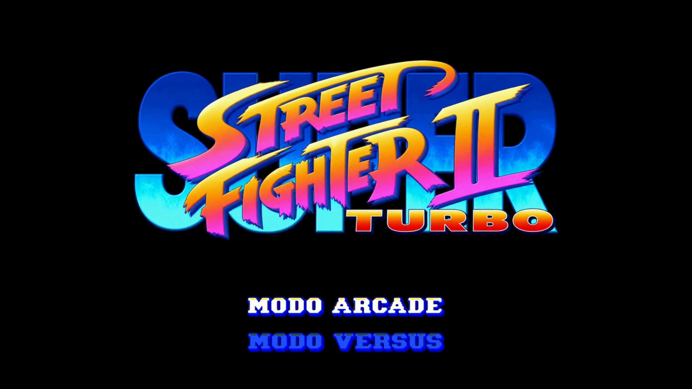
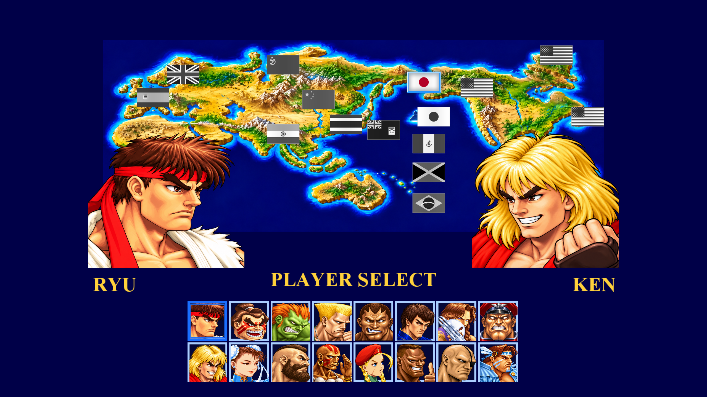
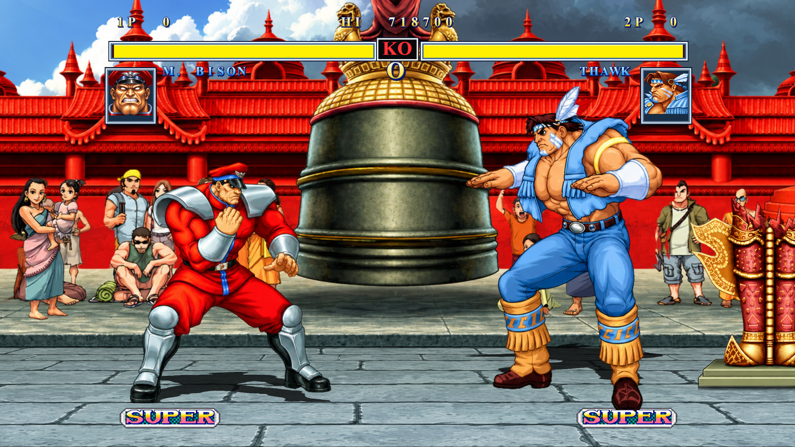
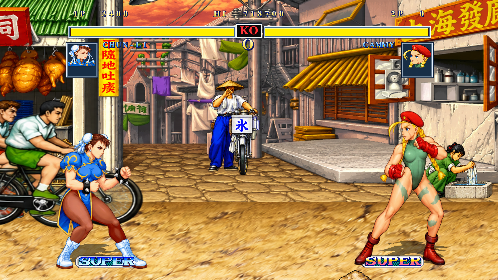
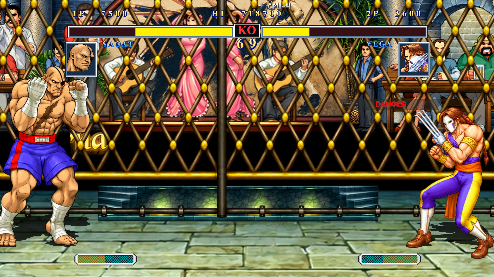
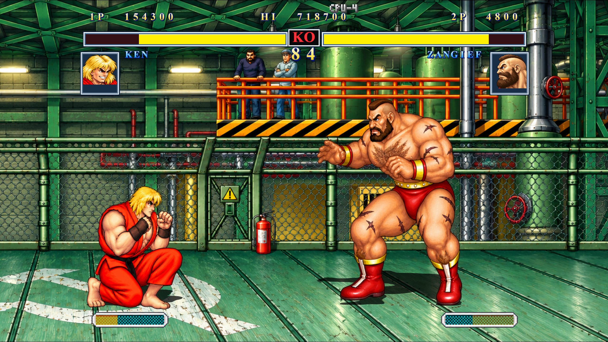
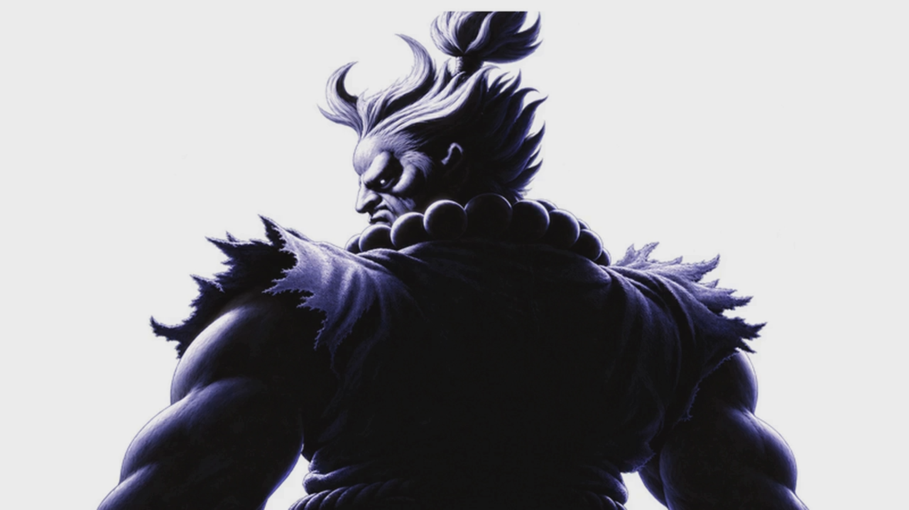
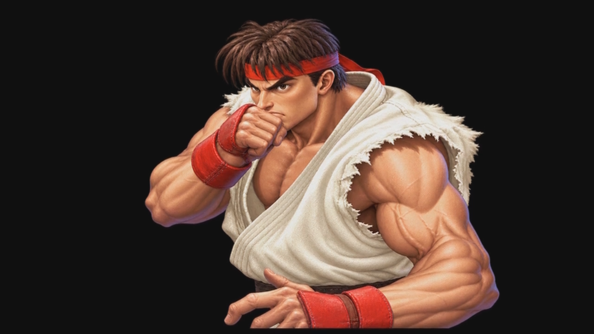

# Super Street Fighter Turbo Remake

Projeto de fã inspirado em **Street Fighter II**, desenvolvido para **Windows** com a base **IKEMEN GO**.

Este espaço apresenta o projeto e acompanha sua evolução. Sugestões sobre o visual, a apresentação e a experiência de jogo são bem-vindas, assim como a troca de ideias com outros fãs de jogos de luta.

## Galeria

Conheça o visual do projeto: menu, seleção de personagens e partidas. Clique em qualquer imagem para abrir o print completo.

| Menu principal | Seleção de personagens |
| --- | --- |
|  |  |
| **M. Bison vs. T. Hawk** | **Chun-Li vs. Cammy** |
|  |  |
| **Sagat vs. Vega** | **Ken vs. Zangief** |
|  |  |

Ver também as artes de apresentação

| Akuma — arte de apresentação | Ryu — arte de apresentação |
| --- | --- |
|  |  |

Gostou do visual? [Conte sua opinião ou sugira uma melhoria](https://github.com/edhard-remakes/Super-Street-Fighter-Turbo-Remake-/issues/new/choose).

## Feito por fã, para a comunidade

Este é um projeto **gratuito e sem objetivo comercial**, feito por um fã que gosta de reviver grandes jogos. A ideia é compartilhar o que for ficando pronto, aprender com outras pessoas e incentivar a comunidade a criar também.

Ferramentas de IA fazem parte desse processo de criação e experimentação. Opiniões, testes, relatos de bugs e sugestões ajudam o projeto a evoluir. Você não precisa saber programar para participar.

## Baixar e jogar

**[Baixar a versão v0.1.0 para Windows](https://github.com/edhard-remakes/Super-Street-Fighter-Turbo-Remake-/releases/tag/v0.1.0)**

Na página da versão, abra **Assets** e baixe o executável do jogo, com aproximadamente **1,23 GB**. Ele reúne a engine e os arquivos necessários. Salve o arquivo no computador e execute-o. Os controles podem ser ajustados pelo menu do jogo.

Esta é uma **versão experimental**. Os arquivos automáticos “Source code” contêm os arquivos deste repositório; o jogo está no executável anexado à versão.

## Sobre o projeto

- Plataforma: Windows.
- Engine: IKEMEN GO.
- Interface personalizada com tema de Street Fighter.
- Elenco configurado com 16 personagens e seus cenários.
- Status: em desenvolvimento.

## Personagens

Ryu, Ken, Chun-Li, Guile, E. Honda, Blanka, Zangief, Dhalsim, Balrog, Vega, Sagat, M. Bison, Cammy, Fei Long, Dee Jay e T. Hawk.

## Acompanhe e participe

O projeto é mantido por [edhard-remakes](https://github.com/edhard-remakes).

**[Relatar um bug, dar uma opinião ou sugerir uma melhoria](https://github.com/edhard-remakes/Super-Street-Fighter-Turbo-Remake-/issues/new/choose)**

Entre com sua conta do GitHub, abra o link acima e escolha o modelo mais adequado. Cada relato vira um tópico onde podemos conversar pelos comentários. Para um bug, conte qual versão usou, o que aconteceu, como repetir o problema e, se possível, inclua uma imagem ou um vídeo.

Ideias sobre jogabilidade, visual, controles, acessibilidade e novos recursos são bem-vindas. As contribuições podem ser tão simples quanto testar uma partida e contar como foi.

## Créditos

- **Street Fighter**, seus personagens e elementos originais: Capcom e respectivos titulares.
- **IKEMEN GO**: equipe e colaboradores da engine.
- Personagens, cenários, fontes, sons e demais recursos da comunidade: seus respectivos autores.

Este é um projeto de fã, sem vínculo oficial com a Capcom. As licenças da engine e dos recursos são distintas; os avisos e créditos originais de cada componente devem ser preservados.

## English

**Super Street Fighter Turbo Remake** is a free, non-commercial fan project inspired by Street Fighter II, built for Windows using IKEMEN GO. It features a custom interface and a configured roster of 16 characters with their stages. AI tools support the creative and experimental process. The project is in development, and feedback, bug reports, playtesting and ideas from the community are welcome. Download the experimental Windows build from **Releases** and join the conversation through **Issues**.
